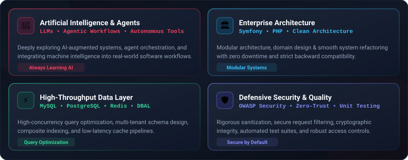

  
    
  
  
    

  <!-- Status & Quick Links Badges -->
  
  
  
  

    
  

 

<!-- ================= ABOUT & ANIMATION SECTION ================= -->
<table>
  <tr>
    <td width="62%" valign="top">
      <h3>👨‍💻 Engineering Profile</h3>
      

        Pragmatic <strong>Senior Software Engineer & System Architect</strong> with extensive experience designing, refactoring, and scaling high-concurrency enterprise web platforms, research management software, and multi-tenant SaaS ecosystems.
      

      <ul>
        <li>🏛️ <strong>Enterprise Architecture:</strong> Designing modular monoliths and resilient backend systems serving large nation-wide institutions.</li>
        <li>🔄 <strong>System Modernization:</strong> Safely transitioning legacy codebases into modern <strong>Symfony LTS (PHP 8.4+)</strong> with strict backward compatibility and zero downtime.</li>
        <li>🛡️ <strong>Defensive Security:</strong> Applying OWASP ASVS standards, zero-trust validation, strict RBAC, and WAF-safe request pipelines.</li>
        <li>⚡ <strong>Database Craftsmanship:</strong> Query optimization, composite indexing strategies, and transactional consistency in MySQL & PostgreSQL.</li>
        <li>🤖 <strong>Agentic Workflows:</strong> Orchestrating specialized AI developer agents and automated pipelines to elevate team velocity and code quality.</li>
      </ul>
    </td>
    <td width="38%" align="center" valign="middle">
      
    </td>
  </tr>
</table>

 

<!-- ================= ARCHITECTURAL PILLARS INFOGRAPHIC ================= -->

  <h3>🏛️ Core Architectural Pillars & Standards</h3>
  

 

<!-- ================= TECH STACK & ECOSYSTEM ================= -->

  
   
  <h3>🛠️ Technologies & Ecosystem</h3>
   
  

 

| Domain | Technologies & Methodologies |
| :--- | :--- |
| **Backend & Architecture** | `PHP 8.4+` `Symfony 7.x LTS` `Doctrine ORM/DBAL` `Clean Architecture` `DDD` `RESTful APIs` `Event-Driven` |
| **Databases & Caching** | `MySQL 8.4` `PostgreSQL` `Redis` `Query Tuning` `Atomic DDL` `Transaction Isolation` |
| **DevOps & Infrastructure** | `Linux (Ubuntu)` `Docker` `DDEV` `WSL2` `Nginx` `Git Workflow` `PowerShell / Bash` `CI/CD` |
| **Frontend & UI Systems** | `Modern JavaScript (ES6+)` `Bootstrap 5` `Tailwind CSS` `Twig` `RTL Design Systems` |
| **Quality & Security** | `PHPUnit` `OWASP ASVS L2/3` `Static Analysis` `Defensive Programming` `Zero-Trust Access Control` |

 

<!-- ================= ACTIVITY & STATS ================= -->

  
   
  <h3>📊 Activity & Contribution Streak</h3>
   

  

    
  
   
  Crafted with engineering craftsmanship & precision • Hossein Hatami

